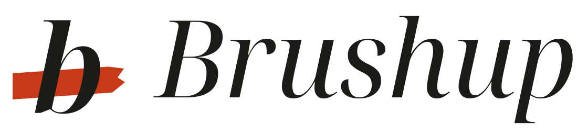

# Brushup logo guidelines

## The idea
A serif italic **b** over a loaded-brush swipe: the letter, finished by hand. The swipe is the touch-up, and it is the only colour in the mark. The italic matches the serif titles in the Brushup panel.

## Files
| Use | File |
|---|---|
| Symbol, full colour (above 40 px) | `symbol.svg` |
| Symbol, small-size cut (16 to 40 px) | `symbol-small.svg` |
| Symbol on dark | `symbol-reversed.svg`, `symbol-small-reversed.svg` |
| Symbol, one colour | `symbol-mono.svg`, `symbol-small-mono.svg` (black; recolour as needed) |
| Wordmark only | `wordmark.svg` |
| Horizontal lockup | `lockup-horizontal.svg`, `-reversed.svg`, `-mono.svg` |
| Stacked lockup | `lockup-stacked.svg`, `-reversed.svg`, `-mono.svg` |
| Favicon, app icon, web icons | `icons/` (`favicon.svg`, `favicon.ico`, `apple-touch-icon.png`, `icon-192.png`, `icon-512.png`, `maskable-512.png`, `site.webmanifest`, `head-snippet.html`) |
| Black and white exports | `exports/` |
| Presentation board | `presentation/board.html`, `presentation/slides/` |

Regenerate everything with `python3 brand/build.py` (needs `fonttools` and the Noto Serif Display fonts).

## Colour
| Name | HEX | RGB | CMYK (approx.) | Use |
|---|---|---|---|---|
| Ink | `#1d1b17` | 29, 27, 23 | 0, 7, 21, 89 | the letter and wordmark; dark tiles |
| Vermilion | `#c73a19` | 199, 58, 25 | 0, 71, 87, 22 | the swipe on light backgrounds |
| Paper | `#faf8f3` | 250, 248, 243 | 0, 1, 3, 2 | light backgrounds; the letter on dark |
| Vermilion (on dark) | `#f06a48` | 240, 106, 72 | 0, 56, 70, 6 | the swipe on dark backgrounds |

Contrast: ink on paper 16.2:1, vermilion on paper 4.9:1, vermilion (on dark) on ink 5.6:1. CMYK values are conversions, not matched swatches; ask your printer to match HEX or a Pantone chip.

## Typography
The wordmark is **Noto Serif Display Italic** (SIL Open Font License 1.1) converted to outlines, with tracking of -6 units. The symbol's letter is Noto Serif Display SemiBold Italic; the small-size cut uses ExtraBold Italic. Do not retype the wordmark: use the SVG.

## Clear space and size
- **Clear space:** keep at least half the symbol's height free on every side.
- **Minimum size:** the full symbol at 40 px; below that use the small-size cut, down to 16 px. The horizontal lockup should be at least 120 px wide, the stacked lockup 80 px.
- Do not use the full symbol as a 16 px favicon; use `icons/favicon.svg` or `favicon.ico`.

## Backgrounds
- **Light:** ink + vermilion on Paper or white.
- **Dark:** use the reversed files on Ink or any background darker than about 20% luminance.
- **One colour:** use the `-mono` files. The swipe becomes a hollow ribbon so the letter and swipe never merge.
- On photos or busy backgrounds, put the mark on an Ink or Paper tile.

## Do not
- Recolour the swipe or add a second accent colour.
- Add gradients, shadows, outlines or effects.
- Stretch, rotate, skew or re-space the mark, or redraw the swipe.
- Separate the swipe from the letter, or use the swipe alone as a logo.
- Use the one-colour mark with solid fills (it will merge into a blob).
- Place the full-colour mark on vermilion or on mid-tone backgrounds.

## Honesty and limits
- No trademark or similar-mark search has been done. Get a professional search before registering or relying on the name or mark.
- Noto fonts are under the SIL OFL; the outlined wordmark may be used in a logo, but check the licence text if you redistribute the font files themselves.
