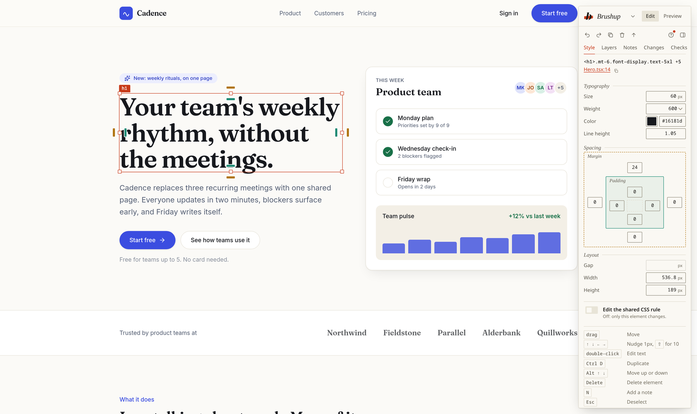

# Cadence: an example to try Brushup on

A small, realistic landing page (React, Vite, Tailwind CSS v4) for a made-up product. It is here so you can try Brushup on something that looks like a real project: components, design tokens, real layout.



```bash
cd examples/cadence
npm install
npm run dev
```

Open the address Vite prints. The Brushup panel is on the page (it is wired in `vite.config.ts` with one line).

## Things to try

- **Double-click the headline** and rewrite it. Open the **Changes** tab to see the one line it changed in `Hero.tsx`.
- **Select a button** and change its size or padding in the Style tab. Brushup writes Tailwind classes.
- **Select a pricing card** and press **Alt+Up / Alt+Down** to reorder it, **Ctrl/Cmd+D** to copy it, **Delete** to remove it. All undoable.
- Open the **Layers** tab and search for `FeatureCard`.
- Open the **Checks** tab. A few small problems were left in on purpose so there is something to find:
  - the grey caption under the hero buttons is too faint (low contrast),
  - the testimonial photo has no alt text (select it and use **Image** in the Style tab),
  - one margin is 15px, which is off the 4px grid.

Everything you do is written into `src/`. Run `git diff` to see exactly what changed, or `git checkout src` to put it all back.
